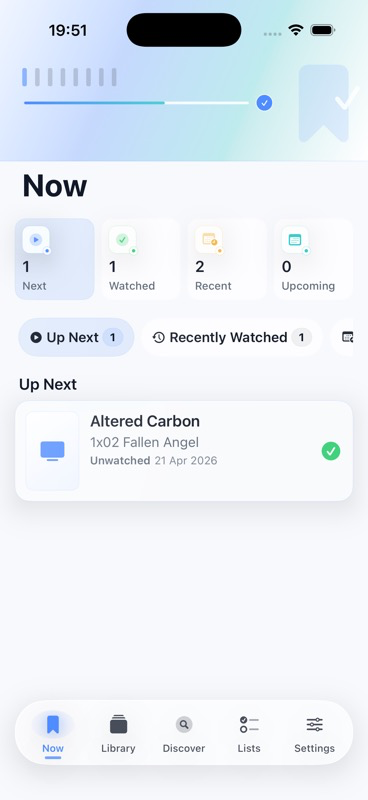
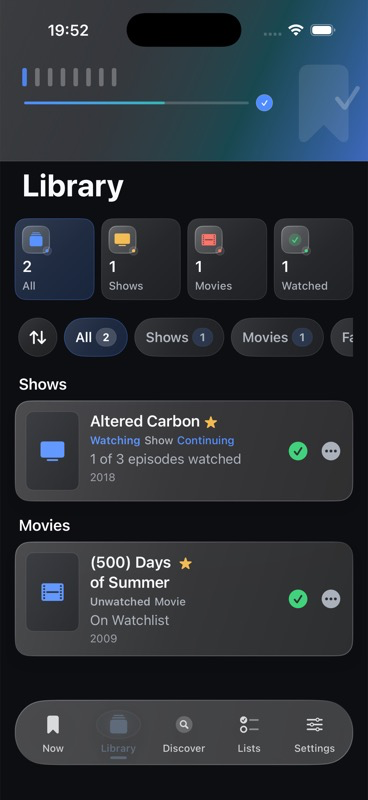
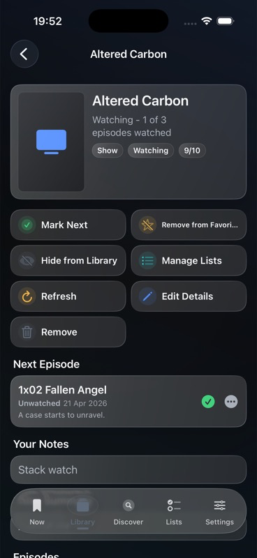
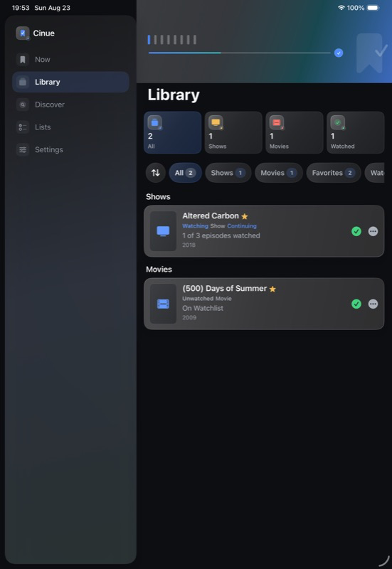

# Cinue

Cinue is a local-first TV show and movie tracker for iPhone and iPad, built with SwiftUI and Core Data.

It provides a private on-device library, episode progress, lists, statistics, local backup and restore, SeriesGuide-compatible JSON import, and optional TMDB-powered discovery and metadata refresh.

> Cinue is an independent open-source project. It is not affiliated with or endorsed by SeriesGuide. SeriesGuide is referenced solely to describe backup-format compatibility.

## Highlights

- Keep a private on-device library of shows and movies, with episode progress, favorites, watchlist, notes, ratings, and custom lists.
- Use the Now tab to follow up next, recently watched, recently aired, and upcoming episodes.
- Discover titles and refresh metadata with an optional user-supplied TMDB credential.
- Export and import Cinue JSON backups, or migrate supported SeriesGuide JSON backups.
- Keep data local: Cinue has no account, analytics, telemetry, or backend.

## Screenshots



| iPhone Library, dark appearance | iPhone detail, dark appearance |
| --- | --- |
|  |  |



## Demo

| Now | Library | Discover and detail |
| --- | --- | --- |
| [](docs/media/clips/cinue-now.mp4) | [](docs/media/clips/cinue-library.mp4) | [](docs/media/clips/cinue-discover-detail.mp4) |

## Requirements

- A Mac with Xcode 26.6 or newer, opened once to install its required components
- An installed iOS Simulator runtime, or an iPhone/iPad running iOS 17.0 or later
- No external Swift packages

## Getting Started

Cinue is currently distributed as source code. There is no prebuilt iPhone/iPad installer or TestFlight download. Use the Simulator to try it on a Mac, or build it for your own device with Xcode.

### Clone and open

In Terminal, from the directory where you keep projects:

```sh
git clone https://github.com/nihal1294/cinue.git
cd cinue
open Cinue.xcworkspace
```

Open the workspace rather than `CinuePackage` alone so the app and test targets are available together. Then choose one of the following paths.

### Run in Simulator

1. Select the **Cinue** scheme in Xcode's toolbar.
2. Select an available iPhone or iPad simulator as the run destination, not **Any iOS Device** or a physical device. If no simulator is available, install an iOS runtime in **Xcode > Settings > Components** and create/select a simulator in the device picker.
3. Choose **Product > Run** or press **Command-R**. Xcode builds Cinue and opens it in Simulator.

A paid Apple Developer membership and a device provisioning profile are not needed for Simulator. You can launch the app without a TMDB credential; the library starts empty until you import a backup, or configure TMDB and add titles through Discover.

### Run on your iPhone or iPad

1. Connect and unlock your device, accept **Trust This Computer** if prompted, and select it as Xcode's run destination. Allow Xcode to finish pairing and preparing the device.
2. In **Xcode > Settings > Apple Accounts** (called **Accounts** in some versions), sign in with your own Apple Account.
3. Select the **Cinue** project in the navigator, then the **Cinue** app target and **Signing & Capabilities**. Enable **Automatically manage signing** and choose your **Team**. A free account appears as a **Personal Team**.
4. Change `PRODUCT_BUNDLE_IDENTIFIER` in `Config/Shared.xcconfig` from `com.nihal.Cinue` to an identifier unique to you, such as `com.yourname.Cinue`. Keep the same identifier for later installs of your copy; changing it creates a separate app and does not move its library.
5. If requested, enable **Settings > Privacy & Security > Developer Mode** on the device, restart it, and confirm the prompt after unlocking. The option may only appear after pairing with Xcode. See [Apple's Developer Mode instructions](https://developer.apple.com/documentation/xcode/enabling-developer-mode-on-a-device).
6. Choose **Product > Run** or press **Command-R**. If the device reports an untrusted developer, follow its prompt to trust your own developer identity under **Settings > General > VPN & Device Management**, then run again.

With a free Personal Team, provisioning expires after seven days and you must rebuild and reinstall through Xcode. This is personal-device testing, not a way to distribute a universally installable app. See [Apple's account and provisioning limits](https://developer.apple.com/help/account/basics/about-your-developer-account).

Export a Cinue backup before deleting the app, changing its bundle identifier, or moving to another device. See the [User Guide](docs/USER_GUIDE.md#import-export-and-backup).

### Optional: enable TMDB discovery

In Cinue, open **Settings** > **Provider Keys** and enter your own TMDB v3 API key or v4 read access token to enable discovery and metadata refresh. See [Privacy](#privacy) for credential storage and artwork requests.

Without a credential, you can still import a supported backup and use local tracking, lists, and statistics. The screenshots show a populated library; a fresh installation does not include that library.

### Build and installation troubleshooting

- **No runnable destination or missing iOS runtime:** install the platform/runtime Xcode requests, then select a specific simulator or connected device. A phone running a newer OS may require a newer Xcode version.
- **Signing requires a development team:** select your own Team for the Cinue app target. If you only want Simulator, check that the destination is actually a simulator.
- **Bundle identifier cannot be registered or provisioning fails:** use a unique identifier, keep automatic signing enabled, and confirm that your Apple Account is signed in. Xcode needs network access to create or refresh device provisioning.
- **The app no longer opens on a Personal Team device:** rebuild and run from Xcode to renew provisioning. Do not delete the app as the first troubleshooting step; export a backup before any deletion.
- **Discover is unavailable or the library is empty:** add your own TMDB credential for discovery, or import a supported backup. An empty library on first launch is expected.

## Importing from SeriesGuide

Cinue can import supported JSON backups produced by SeriesGuide. In **Settings** > **Import and Export**, choose a JSON file from Files. For a SeriesGuide export split across files, import shows first, then movies, then lists so list items can resolve to their matching library entries.

Importing changes the local library. Export a Cinue backup before migrating or replacing data.

## Privacy

Cinue stores watch history, lists, preferences, and imported data locally with Core Data. There is no account, analytics, telemetry, or backend. A saved TMDB credential authorizes discovery and metadata API requests. Remote artwork is fetched separately from the approved `image.tmdb.org` image service when a library item has an approved artwork URL, including an imported or retained URL, and may load without a saved credential. Credentials are user supplied, stored in the device Keychain, and excluded from backups. Your watch history, lists, ratings, notes, and backups remain local.

Automatic iCloud sync is not active. Use the manual JSON export and import flow to move data between devices or keep a copy outside the app.

## User Guide

See the [User Guide](docs/USER_GUIDE.md) for everyday use.

## Testing

Run the feature test suite from the repository root:

```sh
xcodebuild test -workspace Cinue.xcworkspace -scheme Cinue -testPlan Cinue \
  -destination 'platform=iOS Simulator,name=iPhone 17 Pro,OS=26.5' \
  -only-testing:CinueFeatureTests \
  CODE_SIGNING_ALLOWED=NO
```

GitHub Actions runs repository checks, an iOS build, unit tests, UI tests, and static analysis for pull requests and updates to `main`.

## Project Status

Cinue has no tagged releases yet. The project supports local Core Data storage, manual JSON backup and restore, and optional TMDB integration. iCloud auto-sync is not currently active.

## Attribution

This product uses the TMDB API but is not endorsed or certified by TMDB. The app displays TMDB attribution, and the complete provenance and attribution record is in [Third-Party Notices](THIRD_PARTY_NOTICES.md).

## Contributing

Read [Contributing](CONTRIBUTING.md) for development, testing, and pull-request expectations.

## Security

Read the [Security Policy](SECURITY.md) to report a vulnerability privately.

## License

Cinue is licensed under the [Apache License 2.0](LICENSE). See [NOTICE](NOTICE) for copyright notices.
